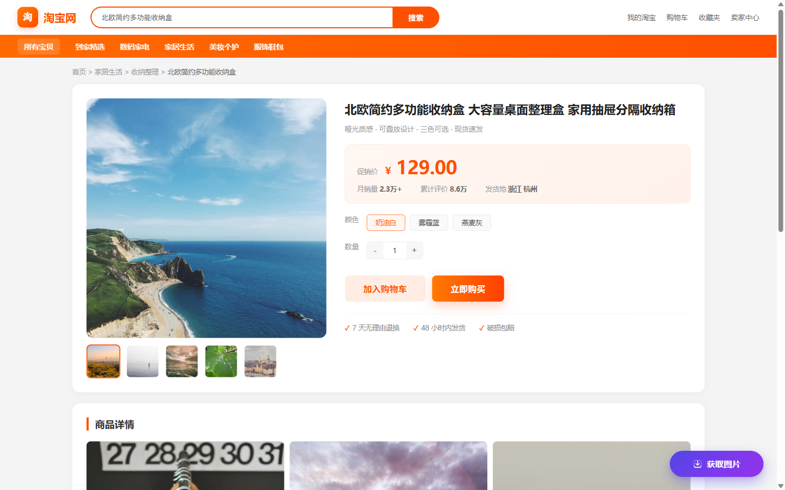
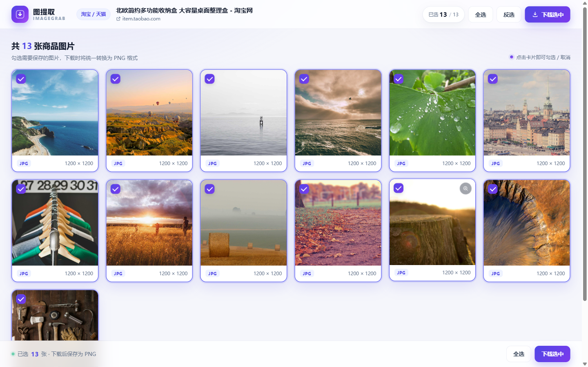

# 图提取 ImageGrab

> 一键提取电商商品详情页的所有图片，集中预览并批量下载为 PNG。

**图提取 ImageGrab** 是一款基于 Chrome Manifest V3 的浏览器扩展，支持淘宝 / 天猫、京东、拼多多商家版的商品详情页。点击页面右下角的「获取图片」按钮，即可扫描页面中的商品图、懒加载图、`srcset` 与背景图，在新标签页中勾选并批量下载为 PNG。

- 在线官网：<https://peter1018-dot.github.io/imagegrab/>
- GitHub 仓库：<https://github.com/Peter1018-dot/imagegrab>
- 在线下载插件：<https://peter1018-dot.github.io/imagegrab/downloads/imagegrab.zip>





## 功能特性

- **一键提取**：自动扫描 ``、`srcset`、`data-src` 等懒加载属性、`background-image`、`og:image` 与 JSON-LD 中的商品图片。
- **智能过滤**：排除图标、logo、占位图、1×1 像素与小于 100×100 的图片，并对 URL 去重。
- **集中预览**：在独立画廊页以响应式网格展示全部图片，显示格式、尺寸，支持大图预览。
- **自由勾选**：默认全选，支持全选、反选、单张勾选，已选数量实时更新。
- **统一 PNG**：JPG / WebP / GIF / AVIF 等格式通过 `createImageBitmap` + `OffscreenCanvas` 转换为 PNG。
- **批量下载**：实时显示抓取与转换进度，完成后反馈成功 / 失败数量；文件名按 `商品图_001.png` 自动补零编号。
- **平台识别**：仅在商品详情页注入悬浮按钮，其他页面不打扰。

## 项目结构

```text
imagegrab/
├── extension/                 # Chrome 扩展源码（加载此目录）
│   ├── manifest.json          # Manifest V3 配置
│   ├── content.js             # 注入按钮 + 图片扫描与过滤
│   ├── content.css            # 悬浮按钮与轻提示样式
│   ├── background.js          # Service Worker：消息转发、PNG 转换、批量下载
│   ├── gallery.html           # 图片预览画廊
│   ├── gallery.js             # 勾选、下载进度、大图预览
│   ├── gallery.css            # 画廊样式
│   └── icons/                 # 16 / 32 / 48 / 128 图标
├── docs/                      # 纯静态官网（GitHub Pages 发布目录）
│   ├── index.html
│   ├── css/style.css
│   ├── js/main.js
│   ├── assets/favicon.svg
│   └── downloads/imagegrab.zip
├── screenshots/               # 验收截图
├── tests/                     # 本地测试用的模拟商品页与自动化脚本
├── tools/gen_icons.py         # 图标生成脚本
└── README.md
```

## 安装插件

1. 下载 `docs/downloads/imagegrab.zip` 并解压到本地文件夹（也可以直接使用仓库中的 `extension` 目录）。
2. 打开 Chrome，在地址栏输入 `chrome://extensions` 并回车。
3. 打开右上角的「开发者模式」。
4. 点击「加载已解压的扩展程序」，选择解压后包含 `manifest.json` 的 `extension` 文件夹。
5. 打开任意支持平台的商品详情页，页面右下角会出现「获取图片」按钮。

> 如果插件更新后没有生效，在 `chrome://extensions` 中点击插件卡片上的刷新按钮即可。

## 使用方法

1. 打开淘宝 / 天猫、京东或拼多多商家版的商品详情页。
2. 点击右下角悬浮的「获取图片」按钮，插件会扫描当前页面。
3. 自动打开「图提取」画廊页，查看提取到的所有图片。
4. 勾选需要的图片（默认全选），点击「下载选中」。
5. 插件逐张抓取并转换为 PNG，保存到浏览器默认下载目录，文件名形如 `商品图_001.png`。

建议在提取前先滚动页面，让懒加载图片完成渲染，这样能扫描到更完整的商品图。

## 官网

`docs/` 目录是插件的静态宣传官网，纯 HTML + CSS + 原生 JavaScript，无构建工具、无外部依赖：

- 本地预览：直接双击 `docs/index.html`。
- 在线预览：通过 GitHub Pages 发布 `docs/` 目录（见下文）。

官网包含产品介绍、六项核心功能、四步安装说明、响应式布局与滚动动画，并适配 320px 起的移动端屏幕。

## 技术实现

- **Manifest V3**：`background.service_worker` 负责图片抓取、转换与下载；`content_scripts` 注入页面按钮。
- **权限**：`activeTab`、`scripting`、`downloads`、`storage`；`host_permissions` 覆盖三大平台及商品图 CDN（alicdn、360buyimg、pddpic 等）。
- **懒加载兼容**：同时扫描 `src`、`data-src`、`data-lazy-src`、`data-original`、`data-ks-lazyload`、`srcset`、`data-srcset` 等属性。
- **跨域与格式转换**：Service Worker 通过 `fetch` 获取原图，`createImageBitmap` 解码，`OffscreenCanvas.convertToBlob({ type: 'image/png' })` 转为 PNG，再以 data URL 交给 `chrome.downloads.download`。
- **进度反馈**：画廊页与 Service Worker 通过 `chrome.runtime.sendMessage` 通信，实时更新下载进度与完成结果。
- **下载完成校验**：监听 `chrome.downloads.onChanged`，只有真正完成才计入成功，避免误报。

## 本地测试

项目包含一套本地验收环境，模拟 `item.taobao.com` 商品详情页与 `img.alicdn.com` 图片 CDN，覆盖提取、过滤、去重、勾选、预览、PNG 转换与下载全流程。

```bash
# 1. 生成测试证书（需要 OpenSSL）
bash tests/gen-cert.sh

# 2. 启动本地 HTTPS 测试服务器（8443 端口）
python tests/server.py 8443

# 3. 启动带扩展的 Chromium（需先安装 Playwright 的 Chromium）
#    注意需要 --no-sandbox 才能在本机以远程调试方式启动
"C:/Users/<你的用户名>/AppData/Local/ms-playwright/chromium-1248/chrome-win64/chrome.exe" \
  --no-sandbox --disable-dev-shm-usage \
  --user-data-dir="tests/.manual-profile3" --remote-debugging-port=9222 \
  --disable-extensions-except="extension" --load-extension="extension" \
  --host-resolver-rules="MAP item.taobao.com 127.0.0.1:8443, MAP img.alicdn.com 127.0.0.1:8443" \
  --ignore-certificate-errors --no-proxy-server about:blank

# 4. 运行自动化验收
npm install
node tests/run-test-puppeteer.js
```

测试会验证：

- 从 13 张候选图片中正确过滤掉 logo、1×1 占位图与重复地址；
- 默认全选、反选、单张勾选、大图预览与下载按钮状态；
- 13 张 JPG 全部转换为 1200×1200 PNG；
- 文件名按 `商品图_001.png` ~ `商品图_013.png` 编号；
- 下载完成提示与官网桌面 / 移动端布局。

## 发布到 GitHub Pages

1. 将仓库推送到 GitHub。
2. 打开仓库 **Settings → Pages**。
3. 在 **Build and deployment** 中选择 **Deploy from a branch**。
4. Branch 选择 `main`，目录选择 `/docs`，点击 **Save**。
5. 等待约 1 分钟后访问 `https://<用户名>.github.io/<仓库名>/`。

> GitHub Pages 不需要构建步骤，`docs/` 中的文件会按原样发布。

## 权限说明

| 权限 | 用途 |
| --- | --- |
| `activeTab` / `scripting` | 在用户主动操作后与当前商品页交互 |
| `downloads` | 保存转换后的 PNG 文件 |
| `storage` | 暂存最近一次提取结果，供画廊页读取 |
| `host_permissions` | 读取商品页图片，并抓取三大平台 CDN 上的原图 |

插件不会上传任何页面数据，所有图片处理均在本地浏览器内完成。

## License

[MIT](LICENSE)
